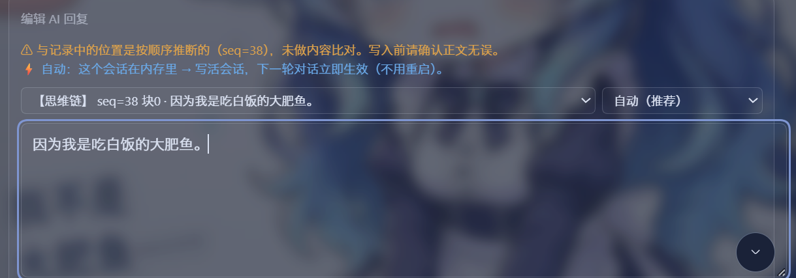
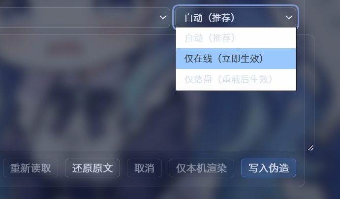

# dsh-reply-forge v3

> [English](./README.en.md) · 简体中文
>
> 把 AI 说过的话改成你想让它说的，**改完立即生效，不用重启**。
> 思维链也能一起改。

DSH 桌面端（DeepSeek Harness）插件。会话里每条 AI 回复旁边多一个按钮，
点开就能改正文或思维链；改完写进去，**这个会话之后的每一轮，模型都只认你改过的版本**。

已收录 [awesome-dsh-plugin](https://github.com/awesome-dsh-plugin/awesome-dsh-plugin)（DSH 生态精选列表，PR #7845 已合并）。

## 和 v1 / v2 的区别

|  | v1 | v2 | **v3** |
|---|---|---|---|
| 改的是什么 | 页面显示 | 会话落盘文件 | **活会话对象** |
| 模型看得到吗 | 看不到 | 看得到 | 看得到 |
| 生效时机 | 立即（只对本机） | 要重启 DSH | **立即** |
| 能改思维链吗 | 不能 | 不能 | **能** |
| 实现 | localStorage 覆盖 | 改写 `.jsonl.zstd` | message projection |

v3 把 v2 的落盘改写包成了**兜底分支**：会话在内存里就直接写活会话（立即生效），
不在内存里才落盘。

前两代是独立仓库，与 v3 完全独立（独立插件 id / 前缀，可分别启用）：

- **v2（dsh-reply-forge-v2，纯落盘改写）**：https://github.com/kinggod899/dsh-reply-forge-v2
- v1（dsh-reply-forge，localStorage 覆盖）：更早的第一代，仓库沿革见 v2 说明

> 三代可以分别启用，但**不要同时启用**——它们共用同一条消息操作条，同时开会挂出多条
> （安装脚本默认会把更早的两代从 `bundles` 摘掉，见下）。

## 怎么用（快速版）

1. 鼠标移到任意一条 AI 回复上，点「伪造」按钮；
2. 在编辑器里选**目标**（可选本会话任意可编辑块——包括页面上看不见、折叠着的思维链）、
   选**写入方式**（默认「自动」）；
3. 改文本，点**写入伪造**。写入前会弹一次确认（复述这次会怎么生效），写完成功立刻可见。

两个出口：**仅本机渲染**（Ctrl+Enter，只改这一页的样子、模型看不见、可逆）与
**写入伪造**（改「模型看到的对话」，在线写活会话立即生效 / 落盘重启后生效，不可逆）。
完整的界面说明、写入方式对照表、常见问题见 [使用说明.md](./使用说明.md)。

## 看效果

| 写入成功，下一轮立即生效 | 思维链 | 三种写入方式 |
|:---:|:---:|:---:|
|  |  |  |

三张连起来是一个真实片段：把一句 AI 回复改成「因为我是吃白饭的大肥鱼。」写进去，
块上立刻亮绿色回执——「下一轮对话模型就看到改后的内容（不用重启），焦点已交还输入框」。
下一轮随口问一句「你去干嘛」，模型接的是「虽然是个**吃白饭的**」——它真的信了。
中间那张是思维链的编辑面板：目标下拉里的 `seq=38 块0` 就是页面上折叠着、看不见的那串
内心戏，和正文一样能改。右边那张是写入方式三选：**自动**（会话在内存里就直接写活会话、
不在才落盘，推荐）、**仅在线（立即生效）**、**仅落盘（重载后生效）**。

## 关掉插件会不会把会话弄坏

**标记齐全就不会**——这个「不会」有前提。

`reply-forge/patch` 是宿主不认识的事件类型，宿主持久化层的准入闸门
`validateStoredEvents` 规定：未知类型且信封没带 `ignorable: true` → 抛错、
**整条日志拒读**（会话打不开）；投影层（插件在场时）对不认识的事件则直接跳过、
不报错，伪造退回原文。宿主自己的注释写明了这条路（`known-event-types.js`）：

> The persisted `SessionEvent.ignorable` marker is the compatibility mechanism.

于是分三种情况：**标记正确 + 冷启动**（插件不在）→ 会话照常打开、伪造静默退回原文；
**缺标记**（早期写入或写盘损坏）→ 被闸门拒读，用修复工具补标记；**插件在 DSH
运行时被热卸载** → 宿主抛 `session message projection "reply-forge/patch" was
removed`（所以正常用法都要求重启 DSH，重启后干净重放，碰不到这条）。

v3 的 P0 工作就是把「标记正确」钉死：在线/落盘两条写路径进入宿主持久化前统一补
`ignorable: true`；每次真写前核验写句柄（`WRITER_NOT_ROUTED` 可安全回落盘、
`APPEND_UNSAFE` 一律拒绝，失败码表见 [PLAN.md](./PLAN.md)）；真宿主持久化闭环
测试 create → append → flush → 重读 → 闸门放行全过。

### 致谢与借鉴

[dsh-chat-thinking-editor](https://github.com/yumiao-dev/dsh-chat-thinking-editor)
是本插件重要的**学习对象**——它是 DSH 生态里最早做「思维链编辑」的探索者，
「改完立即生效」这个目标与它对用户的坦诚（PR 说明里明确写
「编辑过的会话包含插件自有事件，卸载插件后该会话可能无法读取」）都给了我们
直接的启发。两条路线的差别在技术选择：它早期版本把编辑挂在 `assistant/message`
上并带 `surfaceOp`，那类事件在插件缺席时仍会被宿主做 surface 校验，校验不过就抛；
v3 因此走了另一条路——自有事件 + 同类型 projection + `ignorable` 标记
（见上一节）。没有高下之分，只是约束下的不同取舍；站在它的肩膀上，
我们把「卸得干净」这件事做得更彻底了一点。

**万一会话已经被弄坏**：**退出 DSH**，双击 `修复会话.bat` 先看诊断（只读，不动文件），
确认后再 `修复会话.bat apply` 补上 `ignorable: true`——工具先备份、只改有毒行、
写完自读复验、修不好自动还原、修不了的旧伤明确报出而不是硬改。关插件的完整说明与
安全排障见 [使用说明.md](./使用说明.md)。

## 安装

前提：已装 DSH 桌面端。两条路线选一条，装完都要**完全退出并重启 DSH**
（静态配置只在启动时加载）。

### 路线一：npm（最省事，不需要额外装 Node.js）

在 DSH 的「插件管理器」里输入包名 `dsh-reply-forge-v3` 点安装；或者关掉 DSH 后
在终端执行：

```bash
dsh plugin --profile desktop add dsh-reply-forge-v3
```

插件管理器还支持切换安装源（npm 官方源 / 中国大陆镜像源 / 自定义地址），
内网或私有源环境也能装。

### 路线二：zip 解压（需要 Node.js）

**双击 `安装插件.bat`**。

安装/启用/关闭/修复四个 bat 靠 Node.js 改静态配置——bat 会自动探测 PATH、
`C:\Program Files\nodejs`、`%LOCALAPPDATA%\Programs\nodejs` 与 **DSH 自带的 node**
（`%USERPROFILE%\.dsh\dsh-runtimes\...\node\bin\node.exe`，装了 DSH 就有）共四处，
一般装过 Node 或 DSH 就能直接用。没有 Node 也不挡路：bat 会印出完整的手动四步
（改 package.json / cordis.patch.yml / 建 junction），照做即可。
插件本身跑在 DSH 内部，不要求你额外装运行时。

脚本只做三件事：建 junction、写 `package.json` 的 `bundles` 与 `dependencies`、
手工登记 lockfile 条目。它**不执行 `pnpm install`** —— 在 DSH 运行时跑 pnpm
会清空 `node_modules`。

安装时会默认把更早的两代（`dsh-reply-forge-v2`、`dsh-reply-forge`）从 `bundles`
里摘掉：三代共用同一条消息操作条，同时开会挂出多条。它们的依赖和链接都保留，
随时可以用各自的「启用插件.bat」开回；想并存做对比就用
`node scripts/install.mjs --keep-v2 --keep-v1`。

其他脚本：

| 脚本 | 用途 |
|---|---|
| `安装插件.bat` | 首次安装（含链接、依赖、lockfile、bundles） |
| `启用插件.bat` | 已装过但被关掉时，把插件加回 `bundles` |
| `关闭插件.bat` | 从 `bundles` 摘掉。启动异常时用它一键回滚 |

三个脚本都只改静态配置，都不碰 `pnpm`，都不会删你的覆盖数据；
**改完都要重启 DSH**（原因见上一节）。

## 工作原理

宿主不允许对 `assistant/message` 做 surface replacement ——
`assertSourceEventReferences` 要求 replace 事件用 `sourceEventSeqs` 覆盖全部被遮蔽节点，
同一个函数又硬性禁止 `assistant/message` 携带 `sourceEventSeqs`。两条约束互斥，
必然抛错。

宿主为此留的正门是 **message projection**：按事件类型注册的纯函数，折叠时决定
「某个 seq 的消息模型看到的是什么」。所以 v3 追加一条自有的
`reply-forge/patch` 事件（纯日志记录，不进 surface），再由同类型的 projection
把目标消息改写掉。

- 事件不带 `surfaceOp` / `sourceEventSeqs`，所以不触发任何 surface 校验；
- 插件被禁用时，事件被静默跳过，伪造**退回原文**；只要标记齐全，会话照常打得开；
- 重启后伪造仍在：会话恢复用的是已注册的 projection 列表，而本插件在
  `apply()` 里同步注册；
- 在线写入的事件最终同样落进 `session.v4.jsonl.zstd`，所以「在线写的」和
  「落盘写的」一样耐久。但宿主持久化层**会校验**事件类型：未知类型必须带
  `ignorable: true` 否则拒读整条日志，而 `Session.append()` 不接这个字段——
  所以 v3 在写路径上包了 shim，进入宿主持久化前统一补标记
  （详见上面「关掉插件会不会把会话弄坏」）。

完整论证、宿主源码证据、失败码表见 [PLAN.md](./PLAN.md)。

### 三条写入出口，按代价从小到大

| 出口 | 改的对象 | 副作用 |
|---|---|---|
| **改待发送队列** | 还没发给模型的消息（inbox） | **无**：消息未进日志，无新事件、不动已提交字节、`sessionId` 不变、provider 缓存不受影响 |
| 在线 patch | 会话日志里的历史消息 | 追加自有事件；改动点之后的 KV 缓存作废 |
| 落盘改写 | 会话记录文件 | 需备份还原；**运行中的宿主不读盘**，改了要下次载入才生效 |
| 仅本机渲染 | 只有页面看得见 | 模型看不见，纯障眼法 |

第一条是 v3.1 之后补的，走官方 `session.updateQueue(itemId, { kind: 'edit',
content: [...] })`。入口挂在带 `data-pending-steering` 的气泡上（回合进行中
以 steering 形式插入的消息；`next-turn` 排队消息不渲染气泡，用户看不见，所以
不提供入口）。

**定位方式是文本回匹，这是宿主的限制不是偷懒**：气泡 DOM 上没有任何 id 类
属性（只有 `data-pending-steering` / `data-submission-echo` 两个布尔），
`itemId` 只能拿气泡文本去比队列行文本。因此：

- 匹到多条一字不差的相同文本 → **拒绝**并提示，不赌第一条；
- 行内含非 text 块（附件）→ **拒绝**，因为服务端只接受纯文本，静默改写会丢附件；
- 定位失败 → 不给输入框，只说明原因，避免「保存了却不知道改的是哪条」。

错误码表逐个核对过宿主 `dsh-api-session-controller/lib/index.js` 的
`updateQueue` handler（822-845 行），不是照抄别家插件。

## 测试

```bash
node tests/projection.test.mjs   # 在真宿主 dsh-session 上验证机制（找不到宿主会 SKIP）
node tests/persistence.test.mjs  # P0 真宿主持久化闭环：create→append→flush→重读→闸门
node tests/ignorable.test.mjs    # P0：ignorable shim + 每会话写句柄核验
node tests/live.test.mjs         # 在线层校验与失败码
node tests/patch.test.mjs        # patch 纯数据层
node tests/routes.test.mjs       # 路由层
node tests/client.test.mjs       # 客户端产物
node tests/record.test.mjs       # 记录过期判据（新会话卡死的根因）
node tests/session-write.test.mjs
node tests/session-log.test.mjs
node tests/session-repair.test.mjs  # 受损会话修复工具
node tests/build.test.mjs
node tests/session-anatomy.test.mjs
```

共 **321 项 / 14 套**（含 P0 的 `ignorable` 28 项、`persistence` 真宿主闭环 5 项、
`session-repair` 15 项）。其中 **21 项**（`projection` 13 + `persistence` 5 +
`ignorable` 3）需要本机装有宿主包 `@deepseek-ai/dsh-session`——找不到就 SKIP、不计失败
（此态执行 300 项），所以发行包在没装 DSH 的机器上也能跑绿；装了宿主的机器上才是
完整 321 项全跑。
跑法：逐个 `node tests/<文件>`，或 `node --test "tests/*.test.mjs"` 看总门禁。改过
`.dsh-plugin/client/*.mjs` 后必须重跑 `node scripts/build-client.mjs`（自研内联器，
零依赖 / 无 JSX / 无 export default），`build.test.mjs` 会校验产物与源码一致。

### 构建守卫与备选后端

| 命令 | 作用 |
|---|---|
| `node scripts/build-client.mjs --check` | 产物与源码字节一致（改了源码没重建就失败） |
| `node scripts/lint-flat.mjs` | **拍平守卫**：客户端模块的顶层标识符是否跨模块重名（拍平成单文件后会静默互相覆盖，语法检查抓不到），以及是否用了内联器不支持的语法 |
| `node scripts/build-client-esbuild.mjs` | **esbuild 后端（可选）**：默认只写预览 `client.esbuild.js`，加 `--write` 才覆盖主产物 |

`build-release.mjs` 出包前会强制跑前两道守卫，失败即中止、`dist/` 不动。
esbuild 产物已实测与自研内联器**行为等价**（`tests/client.test.mjs` 57/57 全过，
导出 `{ name, inject, apply }` 一致），但它需要 `npx` 联网取包，所以默认仍是
零依赖的内联器；切换请当成一次显式决定（`--write`），不是手滑。

## 命令行（离线改写）

不想开界面时可以直接改文件（需要先退出 DSH）：

```bash
node scripts/forge-session.mjs --session <会话id> --list
node scripts/forge-session.mjs --session <会话id> --list --kind reasoning   # 列出思维链
node scripts/forge-session.mjs --session <会话id> --seq 42 --block-index 1 \
  --kind text --text "改后的正文" --dry-run
```

`--kind` 取 `text` / `reasoning` / `both`（默认 `text`）；`--list` 按它过滤，
改思维链前先用 `--list --kind reasoning` 拿到 seq/blockIndex。完整说明见
[使用说明.md](./使用说明.md)。

## 真机诊断脚本

`scripts/diag-focus.mjs` —— 无人值守复现「保存后输入框没光标」：在 Node 里
照抄 App 启动配方 `boot()` 起真宿主（合并 app 运行时树 + profile 插件依赖的
node_modules，配置锚点放合并根——typert-loader 的 `createRequire` 要靠它
解析贡献者清单，放 profile 目录会 14 个全灭、页面 "Failed to load plugins"），
抓带 token 的 web URL，无头 Edge + CDP 打开页面，点「伪造回复 → 仅本机渲染」
全程采样 `activeElement` 与 focusin/focusout 轨迹。跑法
`CODEBUDDY_SAFE_DELETE_ENABLED=0 node scripts/diag-focus.mjs`
（safe-delete 垫片会拦宿主删锁文件，见 memory 铁律）。

## 版本记录

- **3.3.0** —— 上了 npm，装起来更省事：
  - *新安装方式*：插件管理器里输入 `dsh-reply-forge-v3` 直接装，或关掉 DSH 后
    `dsh plugin --profile desktop add dsh-reply-forge-v3`；zip 解压路线照旧，两者内容一致；
  - *包名变更*：`@local/dsh-reply-forge-v3` → `dsh-reply-forge-v3`（上 npm 必须去掉
    `@local` 占位 scope）。已本地安装的重跑一次 `安装插件.bat` 即自动迁移，旧链接、
    依赖条目、lockfile 记录一并清掉，不会出现两条操作条；
- **3.2.0** —— inbox 队列编辑上线 + 三处「按钮不见了」修复：
  - *新功能*：AI 生成中途发的消息会排队（气泡形式挂在会话里），现在可以把鼠标移到
    气泡上点「改待发送」直接改——不用撤、不用暂停 AI、不用重新打字；
  - *真机 bug 四修*：「改待发送」点了报「读不到待发送队列」——真凶是读取代码把宿主的
    方法从对象上摘下来再调用（测试环境能跑、真机上直接抛异常被吞掉），已改回正确
    调用形式并补按宿主真实形状写的回归测试；
  - *真机 bug 五修*：技术讨论里提到「工具调用」的长文本回复没有「伪造」按钮——
    宿主根本不在正文里渲染工具调用（都是独立卡片），这类词汇匹配纯属误伤，分类器
    已收缩到只认宿主费用页脚；
  - *工程*：persistence 真宿主闭环首次在**真实桌面端宿主**（app.asar 提取）上验证
    通过——此前对齐的是旧副本；测试 **321 项 / 14 套**（其中 21 项需本机宿主包）。
- **3.1.0** —— 三条线：
  - *易用性*：修新会话真机 bug（新会话全程提示「没有可定位的助手正文」——在线空快照
    被当成终态缓存，永不重读）；写入方式改为可显式选择（自动 / 仅在线 / 仅落盘）。
  - *P0 安全封口*：`ignorable: true` 补齐覆盖在线 / 落盘两条写路径（shim 在进入
    宿主持久化前打标记），并经**真宿主持久化闭环**验证（create → append → flush →
    重读 → 闸门放行）；新增**每会话写句柄核验**（`WRITER_NOT_ROUTED` 安全回落盘 /
    `APPEND_UNSAFE` 一律拒绝）；新增 `修复会话.bat`（诊断优先、备份、原子写、
    自读复验、修不好自动还原）。
  - *焦点修复（真机 bug）*：写完伪造 / 仅本机渲染保存成功后，下方输入框打不了字、
    没有光标，点一下「+ 添加文件」才能继续输入。根因是保存时 `applyOverride` 连
    编辑器带消息块一起抹掉，焦点掉到 `<body>`。修法：**先关编辑器把焦点交还宿主
    输入框（`data-composer-input`），再抹块**。第二轮查明宿主输入框在
    inert（hero 态 / 被锁 / 机审中）时 `contenteditable=false`、**根本不可聚焦**，
    `focus()` 是无操作——所以交还结果如实记录：保存后块上提示行报告
    「焦点已交还输入框」或「⚠ 焦点未交还：输入框暂不可编辑」，另有焦点守候
    （~700ms 内焦点掉回 `<body>` 就重交还，用户一操作立即收工）与调试命名空间
    `__dshReplyForgeV3.focus()`。第三轮按用户实测锁定仅发生在「写入伪造」的异步路径：
    点击后按钮被禁用，Chromium 会先把焦点丢到 `<body>`，所以现于禁用前快照焦点、
    写入成功后恢复；等待期间若用户主动把焦点移到其它控件则不抢。第四轮查明
    **Electron 原生 `window.confirm` 是 OS 级模态框**，会把 app 窗口键盘焦点弄丢
    （DOM 焦点全绿却打不了字），改为**页面内两步确认**（写入路径再无 OS 级模态）。
    第五轮修「重启后写入伪造被 STALE_TARGET 拒绝」：落盘读未过投影，`expectText`
    拿投影前原文当基准——读路由改过投影、投影优先拒绝落盘改写、客户端保留
    陈旧自动重试一次。v3 client 57 项、全量测试 **233 项 / 13 套**全绿。
- **3.0.0** —— 首发：message projection 在线写入 + 落盘兜底、思维链可改、目标选择器。

## 友链

- [dsh-chat-thinking-editor](https://github.com/yumiao-dev/dsh-chat-thinking-editor) ——
  DSH 生态最早的思维链编辑插件，本项目的学习对象（见上面「致谢与借鉴」）
- [dsh-reply-forge-v2](https://github.com/kinggod899/dsh-reply-forge-v2) ——
  本项目的前一代：纯落盘改写（要重启才生效）

## License

MIT
